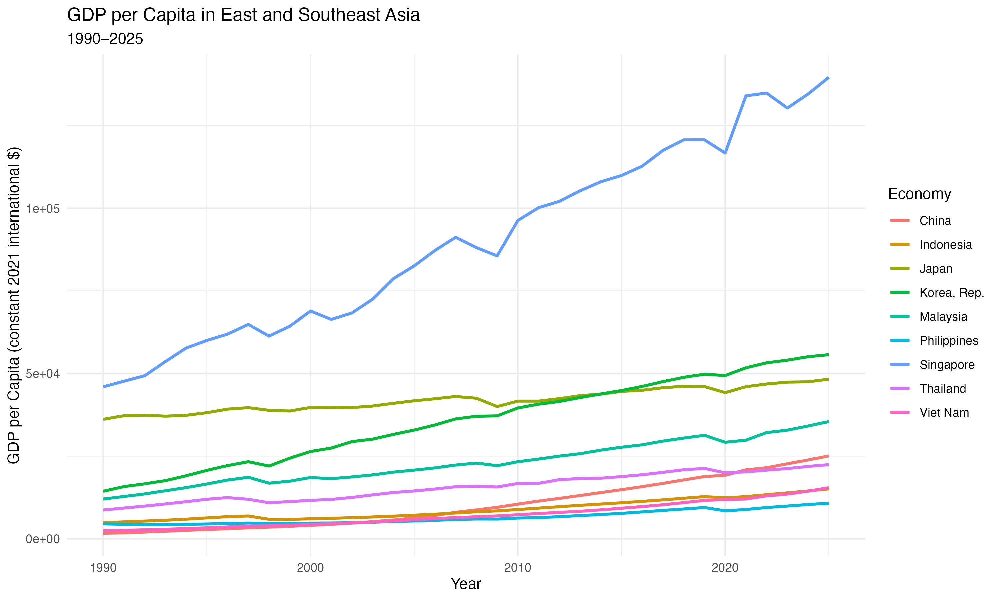
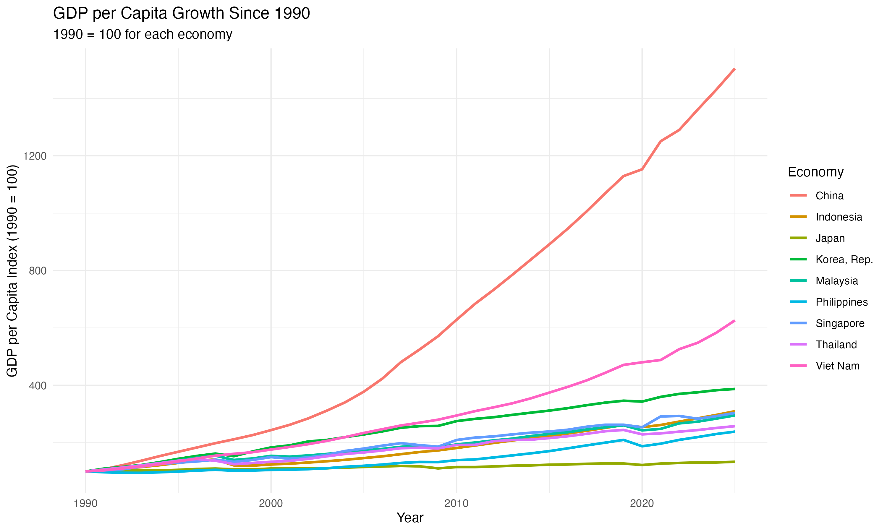
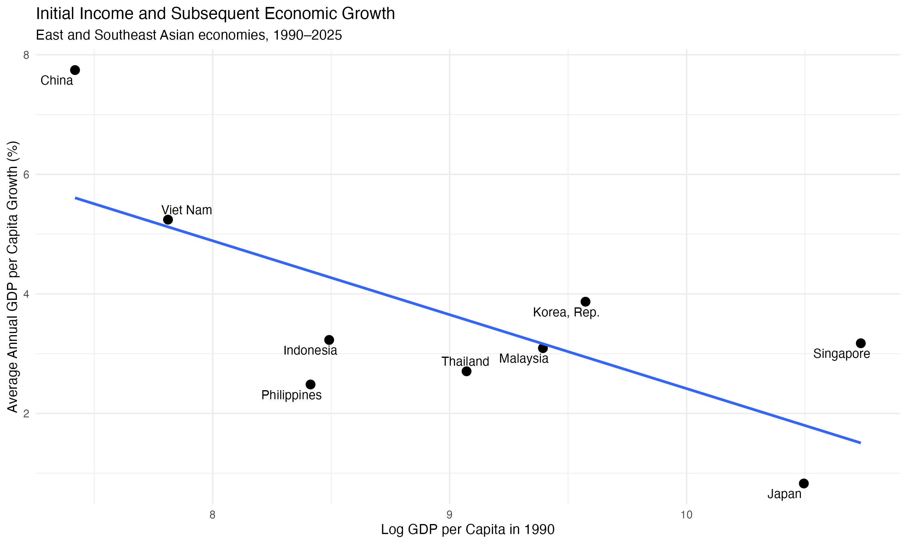

```{r setup, include=FALSE}
knitr::opts_chunk$set(
  echo = TRUE,
  warning = FALSE,
  message = FALSE
)

library(tidyverse)
library(ggrepel)
```

## Introduction
Countries begin with different levels of economic development. Economic convergence is an idea in which countries with lower initial GDP per capita may experience faster growth than higher-income economies, potentially reducing the income gap over time. The economies of East and Southeast Asia include both high-income and developing economies with different rates of economic growth. To examine economic convergence, this project compares GDP per capita growth across nine East and Southeast Asian economies from 1990 to 2025. This analysis examines whether initial GDP per capita is negatively associated with subsequent economic growth.

## Data and Setup
The analysis is based on GDP per capita Data obtained from the World Bank's World Development Indicators (WDI) Database. The sample consists of nine East and Southeast Asian economies over the period 1990–2025. GDP per capita is measured using PPP-adjusted constant 2021 international dollars (indicator: NY.GDP.PCAP.PP.KD).

```{r load-Data, include=FALSE}
gdp_Data <- read_csv("Data/gdp_per_capita_clean.csv")
```


## Methodology
Average annual GDP per capita growth was calculated using the difference in the natural logarithms of GDP per capita between 1990 and 2025, divided by the number of years and multiplied by 100. This measure allows economic growth to be compared across countries with different initial income levels.

To test for β-convergence, a simple linear regression was estimated with average annual GDP per capita growth as the dependent variable and the natural logarithm of initial GDP per capita in 1990 as the independent variable. A negative estimated coefficient indicates that economies with lower initial income tended to experience faster subsequent economic growth, which is consistent with β-convergence.

## GDP per Capita Trends

**Data source:** World Bank, World Development Indicators (WDI).
[GDP per capita, PPP (constant 2021 international $)](https://Data.worldbank.org/indicator/NY.GDP.PCAP.PP.KD).



While GDP per capita increased over time, there were large differences in incomes across the economies. This suggests that economic growth does not automatically imply that income gaps are narrowing. 


## GDP per Capita Growth Relative to 1990



China and Vietnam, both with relatively low GDP per capita at the start, experienced some of the highest proportional growth from 1990 to 2025. This pattern is consistent with economic convergence, but the graph alone does not provide conclusive evidence of convergence across the entire sample.


## Beta-Convergence Analysis



The downward-sloping regression line indicates that economies with lower GDP per capita in 1990 tended to have higher average annual growth between 1990 and 2025. China and Vietnam experienced relatively rapid growth despite starting with lower GDP per capita, while Japan grew comparatively slowly despite its higher initial income. The fitted line indicates a negative relationship consistent with β-convergence across the sample.


### Regression Results

| Statistic | Estimate |
|-----------|----------|
| Beta coefficient | -1.2363 |
| p-value | 0.0290 |
| R-squared | 0.5172 |
| Observations | 9 |

The estimated β coefficient of −1.2363 shows a negative relationship between initial GDP per capita and average annual growth, which is consistent with β-convergence.

With a p-value of 0.0290, the estimated coefficient is statistically significant at the 5% level, providing evidence consistent with β-convergence across the nine economies.

The R² value of 0.5172 indicates that differences in log initial GDP per capita account for approximately 51.7% of the variation in average annual GDP per capita growth across the nine economies in the fitted model.


## Robustness Analysis

Robustness checks are performed by excluding potentially influential economies to determine whether the estimated relationship between initial GDP per capita and subsequent growth remains consistent.

| Model | Beta coefficient | p-value | R-squared |
|---|---:|---:|---:|
| Full sample | -1.236 | 0.029 | 0.517 |
| Excluding China | -0.698 | 0.141 | 0.324 |
| Excluding Singapore | -1.688 | 0.0135 | 0.666 |
| Excluding both | -1.105 | 0.0633 | 0.531 |

The statistical significance of the results differs depending on the sample, even though all four models exhibit negative coefficients. Removing Singapore results in a stronger negative association, whereas removing China weakens the statistical evidence for β-convergence. These results indicate that the baseline estimates should be interpreted cautiously, as individual economies can substantially influence the findings.


## Conclusion

The analysis examined whether economies with lower initial GDP per capita experienced faster long-run growth. The findings provide evidence consistent with β-convergence by showing a negative relationship between initial income and subsequent economic growth. However, the strength of these conclusions is limited by the small sample size and the sensitivity of the estimates to individual economies. Overall, the results provide suggestive evidence of economic convergence across the sample, but further research would be needed to draw more definitive conclusions.

Although the results are consistent with β-convergence, they do not necessarily imply that the income gaps among the nine economies have narrowed over time, because σ-convergence was not directly tested.